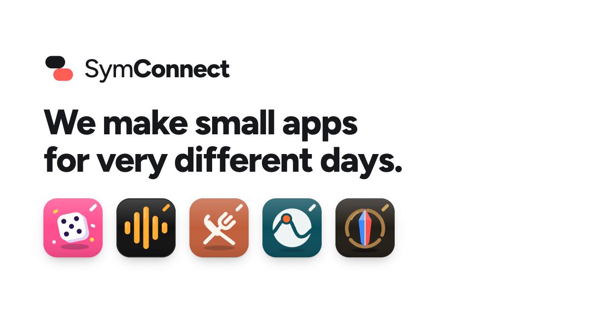

  

**SymConnect** is a small studio of builders in Belgium. We make small apps for very different days: a party game, a music room, a family meal planner, a sales route planner and an arena brawler. Each app has its own look; they share one logo system, the little slash in the corner.

| App | What it is | Try it |
|---|---|---|
| **SymParty** | Roll the dice, crush the minigames, backstab your friends. A 3D party board game for up to 8 players. | Coming soon |
| **SymJam** | Take turns DJing for the room. | [jam.symconnect.be](https://jam.symconnect.be) |
| **SymBite** | One meal for the whole family, portioned for each person. | [symbite.vercel.app](https://symbite.vercel.app) |
| **SymPulse** | Plan efficient days of customer visits from your phone. | [pulse.symconnect.be](https://pulse.symconnect.be) (invite only) |
| **SymClash** | Random heroes, one bridge, 5v5 teamfights in your browser. | [clash.symconnect.be](https://clash.symconnect.be) (early playtest) |

More about the studio and each app at [symconnect.be](https://symconnect.be).
